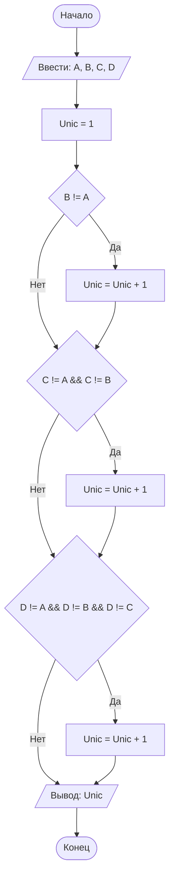

## Отчет по лабораторной работе № 1

#### № группы: `ПМ-2601`

#### Выполнила: `Ильюшкина Софья Сергеевна`

#### Вариант: `9`

### Cодержание:

- [Постановка задачи](#1-постановка-задачи)
- [Входные и выходные данные](#2-входные-и-выходные-данные)
- [Выбор структуры данных](#3-выбор-структуры-данных)
- [Алгоритм](#4-алгоритм)
- [Программа](#5-программа)
- [Анализ правильности решения](#6-анализ-правильности-решения)

### 1. Постановка задачи

> Четыре квадрата с длинами сторон A, B, C и D пытаются расположить
друг над другом, начиная с самого большого. Можно ли разместить все
квадраты так, чтобы каждый следующий был строго меньше предыдущего? Вывести количество квадратов, которые удастся разместить в таком
порядке. На вход программы подаются натуральные числа A, B, C, D.

Решение данной задачи сводится к нахождению количества уникальных чисел среди `A`, `B`, `C`, `D`. Вне зависимости от величин исходных чисел, любые попарно-различные числа, всегда можно упорядочить строго по убыванию. В контексте задачи - расставить квадраты так, чтобы каждый следующий был строго меньше предыдущего. Если среди квадратов находятся неуникальные(длины сторон совпадают), то из всей группы таких неуникальных квадратов мы можем разместить только 1 из них. Соответственно количество квадратов, размещённых таким образом, чтобы выполнялось условие задачи, будет равно количеству уникальных чисел среди `A`, `B`, `C`, `D`.

Пример: 
Даны стороны `5`, `3`, `5`, `2`, мы можем составить башню из квадратов со сторонами `5`, `3` и `2` (всего 3 квадрата). Второй квадрат со стороной `5` мы использовать не сможем, так как он не будет строго меньше предыдущего.

### 2. Входные и выходные данные

**Данные на вход**

На вход программы подаются 4 натуральных числа: `A`, `B`, `C`, `D`. Так как числа натуральные, то минимальное возможное значение каждого 1. Поскольку в условии задачи верхняя граница для натуральных чисел явно не указана, буду предполагать, что значения сторон лежат в пределах разумных вычислений. Тогда для реализации программы выбираю стандартный тип int, из чего следует, что максимальное значение каждого из чисел равняется 2^31-1.


|             | **Тип**               | **min значение** | **max значение**    |
| ----------- | ----------------------| -----------------|---------------------|
| A (Число 1) | Натуральное число     | 1                | 2<sup>31</sup>-1    |
| B (Число 2) | Натуральное число     | 1                | 2<sup>31</sup>-1    |
| C (Число 3) | Натуральное число     | 1                | 2<sup>31</sup>-1    |
| D (Число 4) | Натуральное число     | 1                | 2<sup>31</sup>-1    |

**Данные на выход**

Так как программа должна вывести количество уникальных квадратов, то выходные данные по определению будут натуральными числами от 1 до 4.

|         | **Тип**             | **min значение** | **max значение** |
| ------- | --------------------| -----------------| -----------------|
| Число 1 | Натуральное число   | 1                | 4                |

### 3. Выбор структуры данных

На основе рамок, определенных в предыдущем пункте, мы окончательно берем тип int для переменных (`A`, `B`, `C` и `D`), так как наши числа натуральные и полностью укладываются в его диапазон

|             | **название переменной** | **Тип (в Java)** |
| ----------- | ------------------------| ---------------- |
| Число 1     | `A`                     | `int`            |
| Число 2     | `B`                     | `int`            |
| Число 3     | `C`                     | `int`            |
| Число 4     | `D`                     | `int`            |
| Число 5     | `Unic`                  | `int`            |

Для вывода результата создаю и использую дополнительную переменную-счетчик `Unic` типа `int`, так как максимальное возможно значение `Unic` = 4, а минимальное = 1

### 4. Алгоритм

**Алгоритм выполнения программы:**
1. **Ввод данных:**
   Программа считывает с клавиатуры 4 натуральных числа обозначенных как `A`, `B`, `C` и `D`.
2. **Инициализация счётчика:**
   Программа создает переменную-счетчик `Unic` и присваивает ей начальное значение `1`. Мы заранее считаем первый квадрат уникальным, так как его пока не с чем сравнивать.
3. **Проверка уникальности второго числа:**
   Программа сравнивает значения переменных `B` и `A`. Если `B` не равно `A`, то значение переменной `Unic` увеличивается на 1.
4. **Проверка уникальности третьего числа:**
   Программа проверяет значение переменной `C`. Если `C` не равно `A` и одновременно не равно `B`, это означает, что число уникально относительное уже проверенных, и `Unic` увеличивается на 1.
5. **Проверка уникальности четвертого числа:**
   Программа проверяет значение переменной `D`. Если `D` не равно `A`, не равно `B` и не равно `C`, то `Unic` увеличивается на 1.
6. **Вывод результата:**
   Программа выводит итоговое значение переменной `Unic` на экран.





### 5. Программа

Полный текст программы с комментариями на русском языке

Нужно вставить код прямо в отчет в блок:

```markdown
    ```java
        class Main{
            // Что-то далее
        }
    ``` 
```

Это будет выглядеть следующим образом:

```java
class Main{
    // Что-то далее
}
```

### 6. Анализ правильности решения

Привести тесты и анализ работы программы для этих тестов.
Очень неплохо было бы обосновать выбор тестов.

1. Тест на что-то

- Input:
    ```
    1
    1
    ```

- Output:
    ```
    2
    ```

2. Тест на что-то еще

- Input:
    ```
    1
    -1
    ```

- Output:
    ```
    0
    ```

# Критерии оценивания

Обратите внимание на то, что лабораторная работа должна быть выложена в отдельный репозиторий с названием LabN (N -
Номер лабы). В репозитории должно быть минимум 2 файла (README.md - отчет, Main.java - код лабы)

| **Критерий**                                                                                                                                                                           | **Баллы**       |
|----------------------------------------------------------------------------------------------------------------------------------------------------------------------------------------|-----------------|
| **Корректность программы**                                                                                                                                                             | **0** - **40**  |
| - Программа полностью выполняет задачу                                                                                                                                                 | 15              |
| - Нет ошибок выполнения                                                                                                                                                                | 10              |
| - Учтены все ограничения                                                                                                                                                               | 5               |
| - Правильное поведение в "крайних" случаях                                                                                                                                             | 10              |
|                                                                                                                                                                                        |                 |
| **Оптимизация кода**                                                                                                                                                                   | **0** - **20**  |
| - Эффективные алгоритмы                                                                                                                                                                | 10              |
| - Избежание избыточности и повторов                                                                                                                                                    | 5               |
| - Разумность использования структур данных                                                                                                                                             | 5               |
|                                                                                                                                                                                        |                 |
| **Читабельность и стиль кода**                                                                                                                                                         | **0** - **20**  |
| - Соблюдение стандартов форматирования                                                                                                                                                 | 5               |
| - Наличие комментариев, в полном объеме поясняющих написанный код                                                                                                                      | 10              |
| - Понятные имена переменных и функций                                                                                                                                                  | 5               |
|                                                                                                                                                                                        |                 |
| **Оформление отчета**                                                                                                                                                                  | **0** - **20**  |
| - Соблюдение структуры отчета                                                                                                                                                          | 5               |
| - Отчет загружен на GitHub в репозиторий с названием LabN (N - номер лабораторной работы), отчет в формате Markdown с названием README.md, также есть файл Main.java с кодом программы | Обязательно     |
| - Четкое описание алгоритма (блок-схема если нужна)                                                                                                                                    | 5               |
| - Полнота покрытия тестами всех случаев                                                                                                                                                | 5               |
| - Обоснования использования алгоритма, структур данных                                                                                                                                 | 5               |
|                                                                                                                                                                                        |                 |
| **Общая сумма**                                                                                                                                                                        | **0** - **100** |
