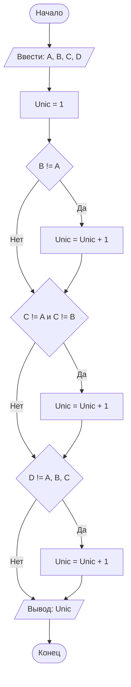

## Отчет по лабораторной работе № 1

#### № группы: `ПМ-2601`

#### Выполнила: `Ильюшкина Софья Сергеевна`

#### Вариант: `9`

### Cодержание:

- [Постановка задачи](#1-постановка-задачи)
- [Входные и выходные данные](#2-входные-и-выходные-данные)
- [Выбор структуры данных](#3-выбор-структуры-данных)
- [Алгоритм](#4-алгоритм)
- [Программа](#5-программа)
- [Анализ правильности решения](#6-анализ-правильности-решения)

### 1. Постановка задачи

> Четыре квадрата с длинами сторон A, B, C и D пытаются расположить
друг над другом, начиная с самого большого. Можно ли разместить все
квадраты так, чтобы каждый следующий был строго меньше предыдущего? Вывести количество квадратов, которые удастся разместить в таком
порядке. На вход программы подаются натуральные числа A, B, C, D.

Решение данной задачи сводится к нахождению количества уникальных чисел среди `A`, `B`, `C`, `D`. Вне зависимости от величин исходных чисел, любые попарно-различные числа, всегда можно упорядочить строго по убыванию. В контексте задачи - расставить квадраты так, чтобы каждый следующий был строго меньше предыдущего. Если среди квадратов находятся неуникальные(длины сторон совпадают), то из всей группы таких неуникальных квадратов мы можем разместить только 1 из них. Соответственно количество квадратов, размещённых таким образом, чтобы выполнялось условие задачи, будет равно количеству уникальных чисел среди `A`, `B`, `C`, `D`.

Пример: 
Даны стороны `5`, `3`, `5`, `2`, мы можем составить башню из квадратов со сторонами `5`, `3` и `2` (всего 3 квадрата). Второй квадрат со стороной `5` мы использовать не сможем, так как он не будет строго меньше предыдущего.

### 2. Входные и выходные данные

**Данные на вход**

На вход программы подаются 4 натуральных числа: `A`, `B`, `C`, `D`. Так как числа натуральные, то минимальное возможное значение каждого 1. Поскольку в условии задачи верхняя граница для натуральных чисел явно не указана, буду предполагать, что значения сторон лежат в пределах разумных вычислений. Тогда для реализации программы выбираю стандартный тип int, из чего следует, что максимальное значение каждого из чисел равняется 2^31-1.


|             | **Тип**               | **min значение** | **max значение**    |
| ----------- | ----------------------| -----------------|---------------------|
| A (Число 1) | Натуральное число     | 1                | 2<sup>31</sup>-1    |
| B (Число 2) | Натуральное число     | 1                | 2<sup>31</sup>-1    |
| C (Число 3) | Натуральное число     | 1                | 2<sup>31</sup>-1    |
| D (Число 4) | Натуральное число     | 1                | 2<sup>31</sup>-1    |

**Данные на выход**

Так как программа должна вывести количество уникальных квадратов, то выходные данные по определению будут натуральными числами от 1 до 4.

|         | **Тип**             | **min значение** | **max значение** |
| ------- | --------------------| -----------------| -----------------|
| Число 1 | Натуральное число   | 1                | 4                |

### 3. Выбор структуры данных

На основе рамок, определенных в предыдущем пункте, мы окончательно берем тип int для переменных (`A`, `B`, `C` и `D`), так как наши числа натуральные и полностью укладываются в его диапазон

|             | **название переменной** | **Тип (в Java)** |
| ----------- | ------------------------| ---------------- |
| Число 1     | `A`                     | `int`            |
| Число 2     | `B`                     | `int`            |
| Число 3     | `C`                     | `int`            |
| Число 4     | `D`                     | `int`            |
| Число 5     | `Unic`                  | `int`            |

Для вывода результата создаю и использую дополнительную переменную-счетчик `Unic` типа `int`, так как максимальное возможно значение `Unic` = 4, а минимальное = 1

### 4. Алгоритм

**Алгоритм выполнения программы:**
1. **Ввод данных:**
   Программа считывает с клавиатуры 4 натуральных числа обозначенных как `A`, `B`, `C` и `D`.
2. **Инициализация счётчика:**
   Программа создает переменную-счетчик `Unic` и присваивает ей начальное значение `1`. Мы заранее считаем первый квадрат уникальным, так как его пока не с чем сравнивать.
3. **Проверка уникальности второго числа:**
   Программа сравнивает значения переменных `B` и `A`. Если `B` не равно `A`, то значение переменной `Unic` увеличивается на 1.
4. **Проверка уникальности третьего числа:**
   Программа проверяет значение переменной `C`. Если `C` не равно `A` и одновременно не равно `B`, это означает, что число уникально относительное уже проверенных, и `Unic` увеличивается на 1.
5. **Проверка уникальности четвертого числа:**
   Программа проверяет значение переменной `D`. Если `D` не равно `A`, не равно `B` и не равно `C`, то `Unic` увеличивается на 1.
6. **Вывод результата:**
   Программа выводит итоговое значение переменной `Unic` на экран.





### 5. Программа

```java
import java.io.PrintStream;
import java.util.Scanner;

public class Main {
    // Объявляем объект класса Scanner для ввода данных
    public static Scanner in = new Scanner(System.in);
    // Объявляем объект класса PrintStream для вывода данных
    public static PrintStream out = System.out;

    public static void main(String[] args) {
        // Считывание четырех натуральных чисел из консоли
        int A = in.nextInt();
        int B = in.nextInt();
        int C = in.nextInt();
        int D = in.nextInt();
        
        // Создаём новую переменную-счётчик, отвечающую за количество уникальных квадратов
        // Первый квадрат изначально считается уникальным и попадает в Unic
        int Unic = 1;
        
        // Если второй квадрат не равен первому, увеличиваем счетчик
        if (B != A) {
            Unic++;
        }
        
        // Если третий квадрат не равен ни первому, ни второму, увеличиваем счетчик
        if (C != A && C != B) {
            Unic++;
        }
        
        // Если четвертый квадрат не равен ни одному из предыдущих, увеличиваем счетчик
        if (D != A && D != B && D != C) {
            Unic++;
        }
        
        // Вывод итогового результата в консоль
        out.println(Unic);
    }
}
```


### 6. Анализ правильности решения

Тесты будут основываться на всех возможных вариантах выходных результатов, то есть на количестве уникальных квадратов.

1. Тест на 4 уникальных значения из (`A`, `B`, `C`, `D`):
   *Проверяем случай, когда все 4 квадрата имеют разную длину стороны. Программа должна учесть каждое значение из (`A`, `B`, `C`, `D`)
   

- Input:
    ```
    4
    5
    8
    6
    ```

- Output:
    ```
    4
    ```

2. Тест на 3 уникальных значения из (`A`, `B`, `C`, `D`)
   *Проверяем случай, когда длины сторон 2 квадратов из 4 совпадают. Программа должна проигнорировать квадрат-дубликат.
- Input:
    ```
    1
    3
    3
    5
    ```

- Output:
    ```
    3
    ```
3. Тест на 2 уникальных значения из (`A`, `B`, `C`, `D`)
   *Проверяем ситуацию, когда квадраты разбиваются на пары одинаковых размеров. Программа должна найти ровно два уникальных значения.
   - Input:
    ```
    2
    9
    2
    9
    ```

- Output:
    ```
    2
    ```
4. Тест на 1 уникальное значение из (`A`, `B`, `C`, `D`)
   *Тестируем последний случай, когда все четыре квадрата имеют одинаковую длину стороны. Программа должна вернуть единицу.
    - Input:
    ```
    8
    8
    8
    8
    ```

- Output:
    ```
    1
    ```
   

